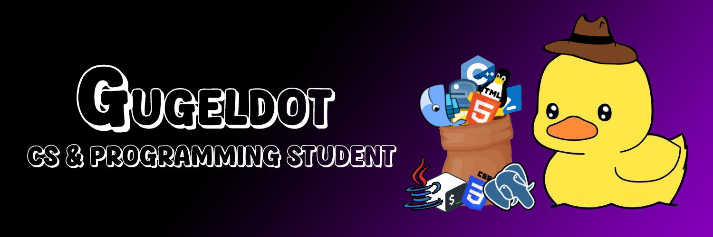
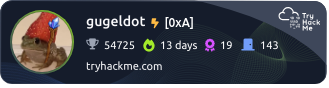
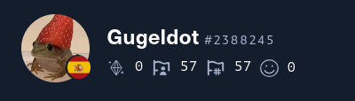

  

  <em>Cybersecurity student exploring OT/ICS security, penetration testing &amp; DevSecOps — CS &amp; Programming background.</em>

  
  &nbsp;
  

 

## 🚀 Projects

<table>
  <tr>
    <td width="50%" valign="top">
      <h3><a href="https://gugeldot.github.io/gugeldots-site/">Gugeldots Site</a></h3>
      
Personal portfolio built to learn HTML, CSS, JavaScript and the GitHub API.

      
      
      
    </td>
    <td width="50%" valign="top">
      <h3><a href="https://gugeldot.github.io/slys-web/">SLYS</a></h3>
      
Lightweight tool that securely fragments and encrypts your files — no cloud, no noise, just pure privacy.

      
      
    </td>
  </tr>
</table>

 

## 🛠️ Tech Stack

  

 

## 📊 Statistics

  
  

